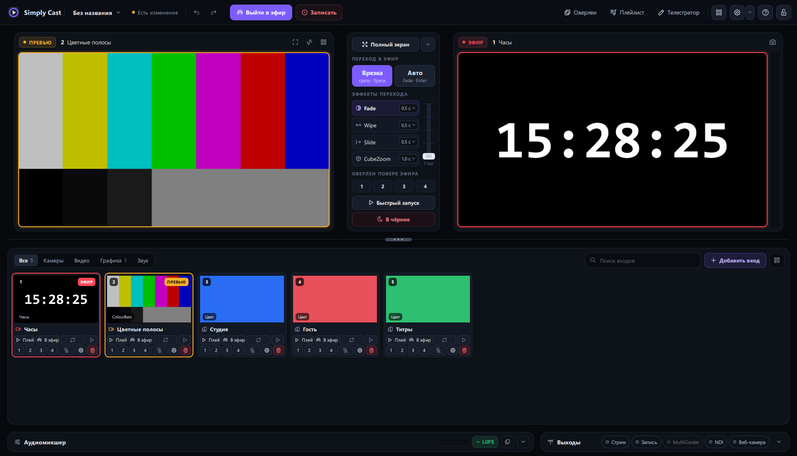

# Simply Cast

**Видеомикшер для Windows. Эфир, запись и стрим — бесплатно, без ключей и подписок.**

## Что умеет

| | |
|---|---|
| 🎬 **Превью и эфир** | врезка и авто-переход, T-bar, 16 переходов, оверлеи, «в чёрное» |
| 🎥 **Источники** | камеры, экран, видео, картинки, NDI, веб-страницы, титры |
| 📡 **Стрим и запись** | файл, RTMP(S), SRT — в несколько направлений, кодирование на NVIDIA/AMD |
| 🔊 **Аудиомикшер** | шины, solo, AFV, метры, громкость в LUFS |
| 🛡 **Надёжность** | сбой камеры не валит эфир, стрим переподключается, проект восстанавливается |
| 📱 **Пульт Android** | живые мониторы, переключение входов, камера телефона как источник |

## Скачать

Файлы последней версии — в разделе **[Releases](https://github.com/petrovich-party/simplycast/releases/latest)**:

| Файл | Для чего |
|---|---|
| `SimplyCast-Setup-0.1.0.exe` | установщик для Windows 10/11 x64 (тихая установка: `/VERYSILENT`) |
| `SimplyCast-Single-0.1.0.exe` | один файл, без установки |
| `SimplyCast-Remote.apk` | пульт для Android |

## Быстрый старт

1. Установите и запустите Simply Cast.
2. Добавьте входы: камера, экран или видеофайл.
3. Выберите вход в превью и переведите в эфир (`Space`).
4. Нажмите **«Выйти в эфир»** или **«Записать»**.

## Лицензии и сведения

Simply Cast использует Qt и FFmpeg по LGPL; тексты лицензий — в папке `licenses` программы. NDI® — зарегистрированный товарный знак Vizrt NDI AB. [Политика конфиденциальности](https://petrovich-party.github.io/simplycast/privacy.html).

© [Petrovich.party](https://petrovich.party/)